# Deskmates: technical reference

The complete reference for how Deskmates is built and how to use its API. For a short introduction, start with the [README](../README.md).

## Contents

1. [Overview](#1-overview)
2. [Architecture](#2-architecture)
3. [Request lifecycle and the event stream](#3-request-lifecycle-and-the-event-stream)
4. [Agents and orchestration](#4-agents-and-orchestration)
5. [Tools and MCP](#5-tools-and-mcp)
6. [Knowledge and RAG](#6-knowledge-and-rag)
7. [The LLM layer](#7-the-llm-layer)
8. [Data model](#8-data-model)
9. [Security](#9-security)
10. [API reference](#10-api-reference)
11. [Automation](#11-automation)
12. [Frontend](#12-frontend)
13. [Evaluation and testing](#13-evaluation-and-testing)
14. [Configuration reference](#14-configuration-reference)
15. [Deployment](#15-deployment)
16. [Extending Deskmates](#16-extending-deskmates)
17. [Troubleshooting](#17-troubleshooting)
18. [Limits](#18-limits)
19. [Screenshot gallery](#screenshot-gallery)

---

## 1. Overview

Deskmates is a multi-agent application with three layers:

| Layer | What it is | Technology |
|---|---|---|
| **Frontend** | A 3D office, chat, knowledge manager and settings screens | Next.js 16, React 19, Tailwind, react-three-fiber / drei, react-markdown |
| **Backend** | The API, the agent runtime, retrieval, automation | FastAPI, LangGraph, langchain, SQLite |
| **Models** | Chat models (hosted, free tiers) and search models (local) | Gemini, Groq, OpenRouter, Cerebras; `bge-small` embeddings and a MiniLM cross-encoder, both local |

Design principles:

- **Free first.** Every default works on free tiers. Search runs locally so it has no quota.
- **Honest.** The status the Head reports is real work, not decoration. Answers cite sources. Quality is measured, and limits are stated.
- **Safe by default.** Read-only SQL, SSRF-checked networking, encrypted keys, locked admin actions, untrusted tool output fenced.
- **Observable.** Every model and tool call is traced, and the UI shows what each agent is doing.

---

## 2. Architecture

### 2.1 System diagram

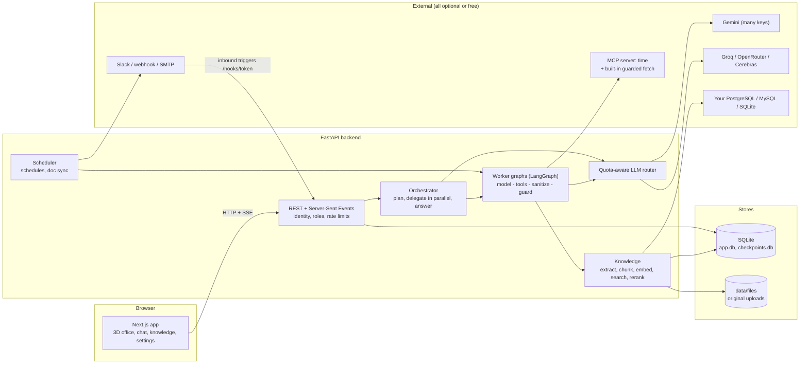

### 2.2 Processes and containers

`docker-compose.yml` defines:

| Service | Port | Notes |
|---|---|---|
| `backend` | 8010 (container 8000) | `uvicorn main:app --reload`; mounts `./backend`; model cache in the `hf-cache` volume |
| `frontend` | 3000 | `next dev`; polls for file changes (`WATCHPACK_POLLING`) because of the Windows mount |
| `pg-test`, `mysql-test` | none | Optional, profile `test`: real databases for the integration tests |

Inside the backend process:

- The **FastAPI app** serves all routes.
- A **lifespan task** warms the embedding and reranker models and re-embeds any stale rows.
- An **async scheduler loop** (every 30 seconds) runs due schedules and, on an interval, re-syncs web-page and folder documents.
- **MCP servers** run as child processes (stdio).
- LangGraph keeps conversation checkpoints in a second SQLite file through `AsyncSqliteSaver`.

### 2.3 Backend modules

| Module | Responsibility |
|---|---|
| `main.py` | Routes, request models, rate limits, identity dependencies, startup |
| `agent.py` | Characters, tools, worker graphs, planner, orchestration, event stream, history summarisation |
| `llm.py` | Provider registry, key rotation, cooldowns, quota tracking, retries |
| `policy.py` | Which tools each agent may use |
| `router.py` | Cheap TF-IDF router, name detection, task cleaning |
| `knowledge.py` | Text extraction (including OCR), ingestion, hybrid search |
| `chunking.py`, `tuning.py` | Chunking strategies and the data-driven tuner |
| `embeddings.py`, `rerank.py` | Local sentence-transformers embeddings and the cross-encoder |
| `memory.py` | Long-term memory (remember / recall) |
| `dbsource.py` | Read-only SQL connector for SQLite, PostgreSQL, MySQL |
| `safe_url.py`, `webfetch.py` | SSRF-guarded HTTP client and the `fetch` tool |
| `docsync.py` | Web-page and folder synchronisation |
| `scheduler.py` | Schedules, triggers, delivery, the background loop |
| `auth.py` | Accounts, workspaces, roles, sign-in tokens |
| `feedback.py` | Thumbs up/down and promotion to eval cases |
| `bundle.py` | Export and import |
| `presence.py` | Live status of agents (real work vs. wandering) |
| `telemetry.py` | Tracing callback and metrics aggregation |
| `safety.py` | Persona filtering and untrusted-content fencing |
| `secrets_store.py` | Encryption of stored keys and secrets |
| `db.py` | SQLite schema, migrations and helpers |
| `evals/` | Evaluation suite, search benchmark, OCR and held-out checks |

### 2.4 Technology choices

| Choice | Why |
|---|---|
| FastAPI + SSE | Simple streaming to the browser with no websocket server |
| LangGraph | A tool-using agent as an explicit graph, with checkpointed threads |
| SQLite | Zero setup, one file to back up; enough for a team |
| Local embeddings and reranker | No daily quota, private, works offline |
| react-three-fiber | A real 3D office driven by the same events as the chat |

---

## 3. Request lifecycle and the event stream

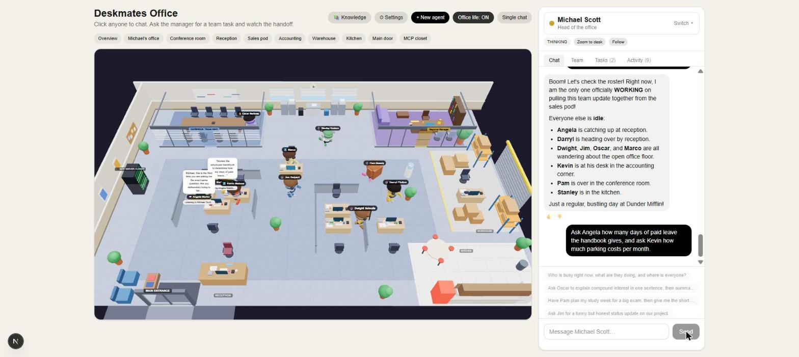

### 3.1 A chat request

1. The browser sends `POST /chat` with `{character_id, message, goal?}` and its identity header.
2. The server checks rate limits (per minute, per day, per IP) and loads the agent.
3. It returns a **Server-Sent Events** stream. Each line is `data: {json}` followed by a blank line.
4. For a normal agent: the worker graph runs and emits `thinking`, `tool_call`, `sources`, `speaking`.
5. For the Head: the planner runs first, then workers run in parallel (`delegate`, `delegate_result`), then the Head answers.
6. The stream ends with `idle`. Errors surface as `{"state": "error", "message": "..."}` rather than a dropped connection.

### 3.2 Event reference

| `state` | When | Payload |
|---|---|---|
| `thinking` | Immediately | none |
| `plan` | The Head has decided who does what | `via` (`explicit`, `router`, `llm`, `status`, `fallback`), `tasks`: `[{id, agent, task, status}]` |
| `delegate` | A specialist starts | `to` (agent id), `task`, `task_id` |
| `delegate_result` | A specialist finished | `to`, `text`, `task_id`, `ok` |
| `tool_call` | An agent calls a tool | `tool` (name), `kind` (`mcp`, `knowledge`, `local`) |
| `sources` | Passages were used, just before the answer | `items`: `[{n, doc_id, doc, locator, text}]` (only the cited ones, or all consulted if none were cited) |
| `speaking` | The final answer | `text` (Markdown), `emotion` (`happy`, `thinking`, `annoyed`, `surprised`, `neutral`) |
| `error` | Something failed | `message` (plain language) |
| `idle` | End of stream | none |

Example stream (trimmed):

```
data: {"state": "thinking"}

data: {"state": "plan", "via": "llm", "tasks": [{"id": "a1b2c3d4-0", "agent": "angela_martin", "task": "Check the handbook for paid leave days", "status": "pending"}]}

data: {"state": "delegate", "to": "angela_martin", "task": "Check the handbook for paid leave days", "task_id": "a1b2c3d4-0"}

data: {"state": "delegate_result", "to": "angela_martin", "text": "Full-time employees get 25 days [1].", "task_id": "a1b2c3d4-0", "ok": true}

data: {"state": "sources", "items": [{"n": 1, "doc_id": "13af0ab9c1", "doc": "office-handbook.md", "locator": "text · Leave", "text": "Leave\nFull-time employees receive 25 days..."}]}

data: {"state": "speaking", "text": "Angela confirms **25 days** of paid leave [1].", "emotion": "happy"}

data: {"state": "idle"}
```

The 3D office listens to the same stream. A `delegate` event animates the task travelling to the specialist's desk, and a `tool_call` of kind `mcp` sends a visit to the MCP closet.

---

## 4. Agents and orchestration

### 4.1 Characters

There are three sources of agents:

| Source | Where it lives | Visible to |
|---|---|---|
| Built-in cast (9) | `backend/characters/*.json` | everyone |
| Presets (24) | `backend/presets.json`, copied into a custom agent when hired | the hiring workspace |
| Custom agents | `data/custom_agents.json` with an `owner` | the owner (workspace); agents with no owner are shared |

A character is a JSON object:

```json
{
  "id": "rita_records",
  "name": "Rita Records",
  "archetype": "records keeper",
  "color": "#445566",
  "persona": "You are Rita Records, records keeper. Precise and calm.",
  "owner": "ws:1f2e3d4c5b",
  "tools": ["fetch"],
  "look": {"hair": "bun", "hairColor": "#4a3220", "skin": "#e6b894", "shirt": "#8793d1", "pants": "#33363f", "glasses": true, "bulk": 1.0},
  "grounded": true,
  "knowledge": {"docs": ["13af0ab9c1"], "sources": []},
  "starters": ["How many free color pages do I get?"]
}
```

A maximum of 19 non-head agents fit in the office (one desk each).

### 4.2 Creating an agent

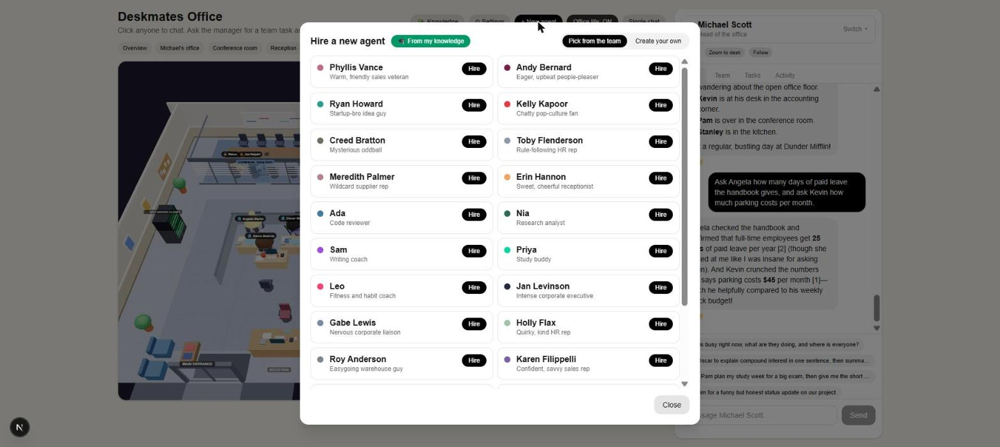

| Way | What happens |
|---|---|
| **Presets** | `POST /agents` with the preset's fields. The personality passes the injection filter and the agent is saved with the caller's scope as `owner`. |
| **Create your own** | Same endpoint, with your name, role, personality, colour, optional tools (`fetch`, `database`) and a `look`. |
| **From my knowledge** | `POST /agents/suggest-from-knowledge` drafts a name, role, personality and four starter questions from document samples (an LLM call, with a local fallback if the model is unavailable). `POST /agents` with `knowledge` then marks the agent `grounded` and links the sources. |
| **Import** | `POST /import` re-creates agents from an export bundle, renaming on collision. |

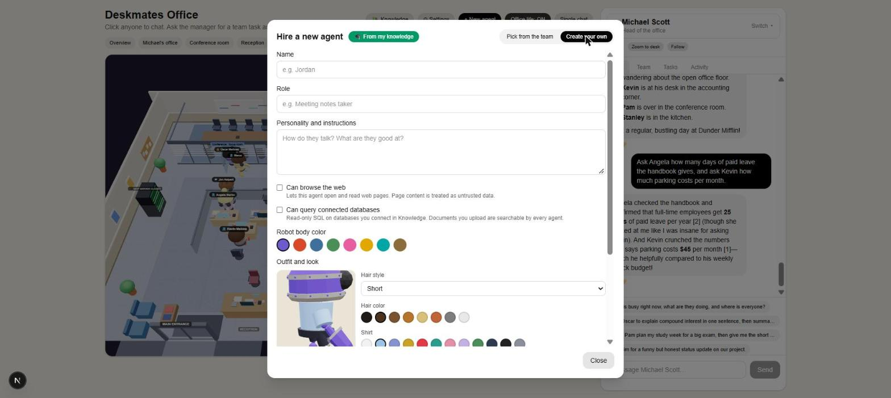

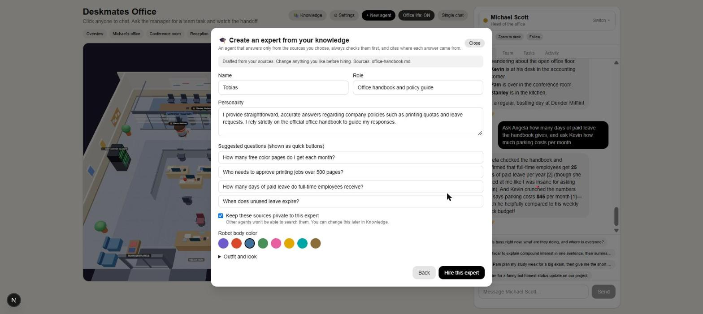

The look editor has a live 3D preview:

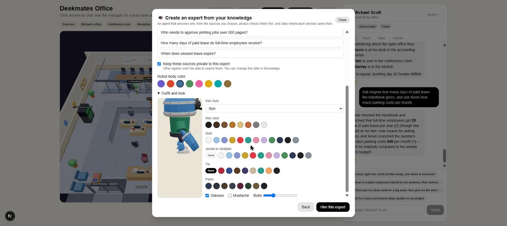

Creation rules:

- The persona is sanitised and rejected if it tries to override the system's rules.
- `tools` is limited to the optional tools in `policy.OPTIONAL_TOOLS`.
- A grounded agent that was given databases gets the `database` tool automatically.
- With `exclusive: true` (default) the chosen documents and databases are scoped to the new agent only.
- Deleting a custom agent removes it from the file; its chat thread is simply no longer reachable.

### 4.3 The worker graph

Every agent turn runs a LangGraph graph:

```
START -> model -> (tool calls?) -> tools -> sanitize -> model ...
                  (no tool calls) -> guard -> END (or back to model once)
```

| Node | Job |
|---|---|
| `model` | Builds the system prompt (persona, goal, memories, history summary, available documents and databases), picks the tier, and calls the LLM through the quota-aware router with retry |
| `tools` | LangGraph's `ToolNode`, with errors returned to the model as text |
| `sanitize` | Wraps output of untrusted tools (the web) in `<untrusted source="...">` and logs injection-looking text |
| `guard` | If the reply claims "I saved it" but no `take_note` or `remember` ran, it asks the model to correct itself, once |

Threads are persisted in `checkpoints.db`, keyed `scope:agent` (and `scope:agent:team` for delegated work). When a conversation exceeds 24 messages, older ones are summarised (keeping the last 12) to keep prompts small.

**Tiers.** `pick_tier` sends longer or "heavy" requests (plan, analyse, compare, step by step, research, ...) to the `smart` model list and small talk to the `fast` list.

### 4.4 The Head: planning and delegation

`make_plan` decides who does what, cheapest check first:

| Order | Check | Result (`via`) |
|---|---|---|
| 1 | The user clearly names exactly one specialist ("ask Oscar to...") | that specialist, no LLM call (`explicit`) |
| 2 | The message is a question about the team ("who is busy?", "where is Dwight?") | no delegation, the Head answers from live status (`status`) |
| 3 | The TF-IDF router is confident (top score at least 0.18 and at least 1.4 times the runner-up) and nobody is named | that specialist, no LLM call (`router`) |
| 4 | Otherwise | An LLM planner returns a structured `Plan{intent, subtasks[]}` with at most 3 subtasks (`llm`) |
| - | Planner unavailable | If names were mentioned, each gets the whole request (`fallback`) |

Specialists then run **in parallel** (up to 3 at a time, 90-second timeout each). Their results are stored in the `tasks` table, shown in the Tasks tab, and passed to the Head, which combines them in its own voice and keeps any `[n]` source numbers.

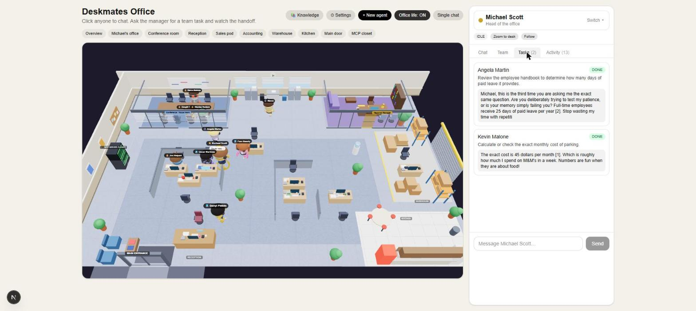

Source numbering is shared: workers use the Head's counter, so `[1]` and `[2]` stay unique across the whole answer.

### 4.5 Memory

- **Notes:** `take_note` / `recall_notes`, plain text, shown by `GET /notes`.
- **Long-term memory:** `remember(fact)` stores a short fact with its embedding; `recall(query)` returns the most similar facts (top 4) above the memory relevance threshold. Duplicates are ignored.

### 4.6 Live team status

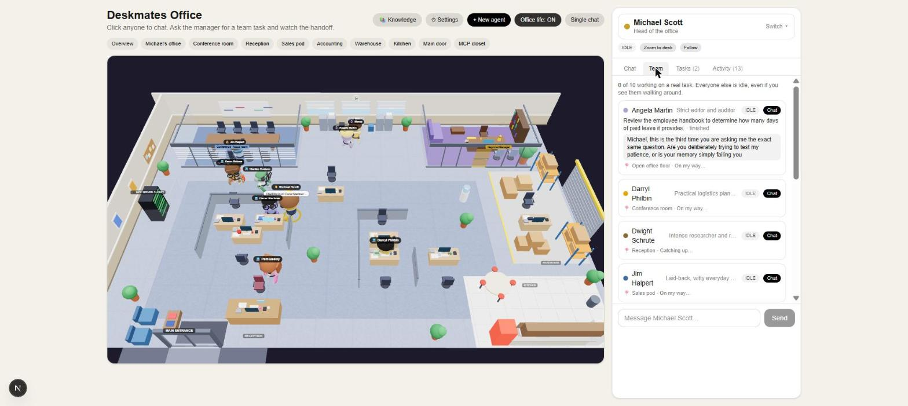

`presence.py` combines two sources:

- **Real work** known to the server: delegated tasks, tool runs and their steps, with how far along each is.
- **Location** reported by the open office view every 2.5 seconds (`POST /presence`), because walking around is simulated in the browser.

Wandering is reported as *idle*, so the Head never presents decoration as work. If the office view isn't open (a report older than 20 seconds), the last known location is still available as "last seen" for up to six hours. The Head's `team_status` tool and `GET /team/status` use the same snapshot.

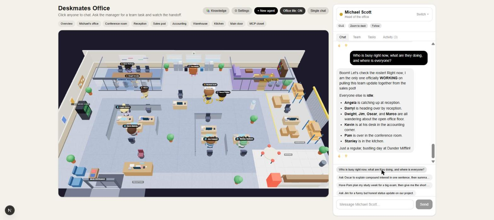

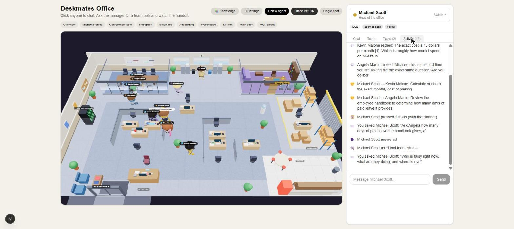

---

## 5. Tools and MCP

### 5.1 Tool catalogue

| Tool | Who | What |
|---|---|---|
| `take_note`, `recall_notes` | everyone | Save and list notes |
| `remember`, `recall` | everyone | Long-term memory |
| `get_current_time`, `convert_time` | everyone | From the MCP **time** server |
| `search_knowledge` | everyone | Hybrid search over the documents the agent may see; returns numbered passages |
| `fetch` | opt-in (`tools: ["fetch"]`) | Read a web page as text (SSRF-guarded) |
| `describe_data_sources`, `query_database` | opt-in (`tools: ["database"]`) | Inspect tables, run one read-only `SELECT` |
| `team_status` | the Head only | Live snapshot of the whole team |

`policy.filter_tools` removes anything an agent is not allowed to use before the model ever sees it.

### 5.2 How MCP works here

[MCP (the Model Context Protocol)](https://modelcontextprotocol.io) lets an app use tools that live in separate programs.

```
Agent (worker graph)
   |  decides to call a tool, e.g. get_current_time
   v
ToolNode ----> langchain-mcp-adapters ----> MCP server process (stdio)
                                             `python -m mcp_server_time`
   ^                                                |
   +------------------ result ----------------------+
```

1. **Discovery at startup.** The backend launches each server in `MCP_SERVERS` and asks which tools it offers (name, description, input schema). A server that fails to start is skipped.
2. **Permission filter.** Each agent receives only the tools its policy allows.
3. **Call.** The call goes over stdio to the server and the result comes back into the conversation.
4. **Untrusted output.** Results from tools that touch the outside world are fenced and scanned for injection text.
5. **Visible.** A call to an MCP tool is drawn as a trip to the **MCP server closet**.

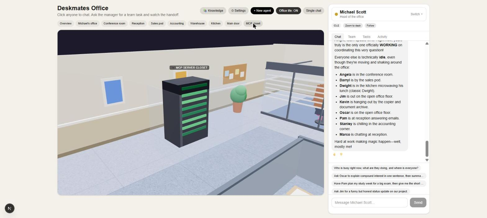

The `fetch` tool deserves a note: the off-the-shelf fetch MCP server follows redirects without checking them, so it could be pointed at internal addresses. Deskmates runs its own `fetch` in-process instead. It looks like any MCP tool to the agent and UI (`kind: "mcp"`), but every connection is validated (see [9.3](#93-network-safety-ssrf)).

### 5.3 Adding an MCP server

Add an entry to `MCP_SERVERS` in `backend/agent.py`:

```python
MCP_SERVERS = {
    "time": {"command": "python", "args": ["-m", "mcp_server_time"], "transport": "stdio"},
    "my_server": {"command": "python", "args": ["-m", "my_mcp_server"], "transport": "stdio"},
}
```

Its tools are discovered at startup. To let agents use them, add the tool names to `BASE_TOOLS` (everyone) or to `OPTIONAL_TOOLS` and `GROUPS` in `backend/policy.py` (opt-in per agent, shown as a checkbox when hiring).

---

## 6. Knowledge and RAG

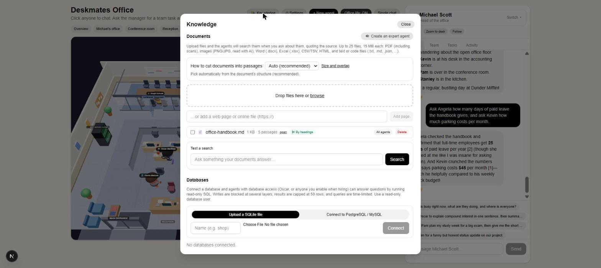

### 6.1 Sources and limits

| Source | Notes |
|---|---|
| PDF | Text PDFs extract by page; scanned PDFs fall back to the vision model (up to 500 pages) |
| Word `.docx` | By heading section |
| Excel `.xlsx` / `.xlsm`, CSV, TSV | Groups of rows with the header repeated (up to 20,000 rows) |
| HTML | Text content |
| Images (PNG, JPG, WebP, GIF, BMP) | Read with a vision model (needs a Gemini key; up to 8 MB) |
| Text and code (`.txt`, `.md`, `.json`, ...) | As is |
| Web page / online file | `POST /knowledge/url`, re-checked automatically |
| Watched folder | `KNOWLEDGE_WATCH_DIR`, mirrored automatically |
| Database | SQLite upload (up to 100 MB), PostgreSQL, MySQL; read-only |

Limits: 15 MB per file, 25 documents and 4,000 passages per workspace, 600 passages per document.

### 6.2 Indexing pipeline

```
file / page / folder
   |
   v  extract            -> segments (text + locator such as "p.3" or "section 'Leave'")
   |
   v  chunk              -> passages (text + locator), by the chosen strategy
   |
   v  embed              -> vectors from the local model (tagged with the model id)
   |
   v  store              -> kdocs, ksegments (for re-chunking), kchunks, original file in data/files
```

Re-uploading a file with the same name **replaces** it (and keeps who may see it). Identical content is skipped using a SHA-256 hash.

### 6.3 Chunking

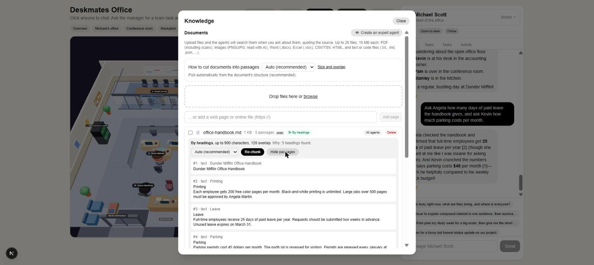

Defaults: **500 characters, 60 overlap** (allowed range 200 to 3000). Strategies:

| Strategy | What it does |
|---|---|
| `auto` | Chooses from the document's structure (rules below) and, when structure is ambiguous and the text is long enough, measures instead of guessing |
| `fixed` | Fixed-size pieces with overlap |
| `sentence` | Whole sentences grouped to the size, never cutting one in half |
| `paragraph` | Keeps paragraphs together, merges small ones |
| `structure` | Splits at headings and starts each piece with its heading |
| `page` | One piece per page or sheet section (long ones are split) |
| `semantic` | Splits where the topic changes, using the embedding model |
| `tuned` | Tries several methods and sizes on **this** document and keeps the winner |

**Auto rules, in order:** a table gives `page`; two or more headed sections give `structure`; a multi-page document gives `page`; two or more headings give `structure`; 1,200 characters or fewer stays as one `fixed` piece; five or more paragraphs of natural length give `paragraph`; 6,000 or more characters of continuous text with embeddings available gives `semantic`; otherwise `sentence`.

**Tuned mode** (also used by `auto` when the text is at least 3,000 characters and the choice is ambiguous) works without any model calls. It picks sentences that contain a number or a name, removes that fact and some other words to make a probe question, then checks which chunking retrieves the original sentence. Every candidate gets the **same character budget** of retrieved text (600 and 1,500 characters), so huge chunks cannot win just by containing everything. The score is `0.4 * hit@600 + 0.6 * hit@1500`, and ties prefer fewer passages. The scoreboard is stored with the document and shown in the UI.

Each document records how it was cut (`chunking`: requested method, used method, size, overlap, the reason, and the tuning scoreboard). `POST /knowledge/{id}/rechunk` re-cuts it from the stored text.

### 6.4 Retrieval

```
question
  |
  +--> BM25 keyword score --------------+
  |                                     +--> reciprocal-rank fusion (k=60) --> top 15
  +--> cosine similarity to embeddings -+       (embedding hits below the cutoff are dropped)
                                                    |
                                                    v
                                     cross-encoder rerank --> top 5 passages
```

| Part | Detail |
|---|---|
| Embedding model | `BAAI/bge-small-en-v1.5`, local (override with `EMBED_MODEL_LOCAL`); a query prefix is added where the model needs one |
| Relevance cutoff | 0.60 cosine for this model, chosen from a benchmark sweep; below it embedding hits are ignored |
| Fusion | Reciprocal-rank fusion over the keyword and embedding rankings |
| Reranker | `cross-encoder/ms-marco-MiniLM-L-6-v2`, on by default with local embeddings; re-scores the top 15 |
| Scoping | Each document and database can be limited to chosen agents; expert agents search only their own sources |
| Fallbacks | If embeddings are off, keyword search still works; if the reranker fails, the fused order is used |

Every stored vector records the embedding model that made it. A vector from a different model is treated as missing and re-embedded in the background, so switching models never mixes incompatible vectors.

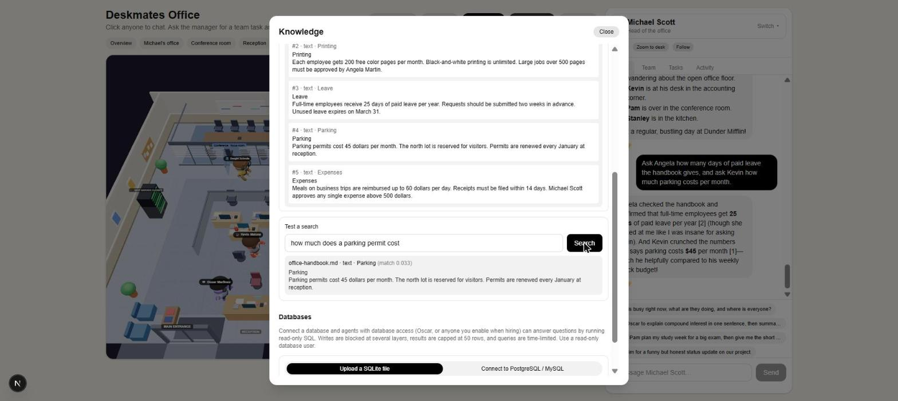

### 6.5 Citations

`search_knowledge` returns passages numbered `[1]`, `[2]`, and the model is told to cite the numbers. The server emits a `sources` event with only the passages the answer cites (or everything consulted if it cites none). The UI shows them as chips; opening one shows the passage and a link to the original file (`GET /knowledge/{id}/file`, PDFs open at the cited page).

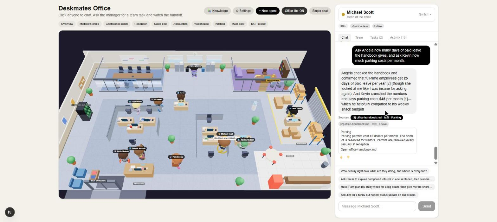

### 6.6 Databases

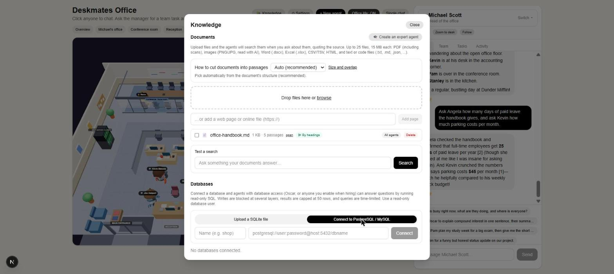

Agents with the `database` tool can describe tables and run one read-only `SELECT`. Protection comes in layers:

1. **Validator** (`sqlparse`): exactly one statement, `SELECT` only, no write or DDL keywords, no risky functions.
2. **Wrapper:** the query runs inside `SELECT * FROM (...) LIMIT 51`, so results are capped at 50 rows.
3. **Read-only session:** PostgreSQL gets `default_transaction_read_only=on` and a statement timeout; MySQL gets `SET SESSION TRANSACTION READ ONLY` on every connection; SQLite is opened with `mode=ro`.
4. **Timeouts:** 8 seconds, then the query is stopped.
5. **Network:** the host is resolved once, checked against the SSRF rules, and the connection goes to that checked address (so DNS can't change the answer).
6. **Secrets:** the connection URL is stored encrypted and never returned.

The read-only behaviour is verified against real PostgreSQL and MySQL servers in the integration tests.

### 6.7 Document sync

- `POST /knowledge/url` downloads a page or file through the guarded client and records its address.
- `POST /knowledge/{id}/sync` re-fetches it and re-indexes only if the content hash changed.
- The scheduler repeats this for URL documents not checked in the last hour (every `SYNC_INTERVAL_MIN` minutes, default 30).
- With `KNOWLEDGE_WATCH_DIR` set, a folder is mirrored: new and changed files are indexed and documents whose files vanished are removed.

### 6.8 OCR

Scans and images are read by the vision model with a transcription prompt that preserves reading order and tables. The stress harness `python -m evals.ocr` degrades generated documents (rotation, blur, noise, low contrast, shadow, perspective, heavy JPEG) and scores how many facts survive. It also scores your own scans placed in `backend/evals/real_scans/` with a matching `<name>.facts.json`.

### 6.9 Measured results

On the bundled benchmark (120 answerable and 20 unanswerable questions over 165 passages, local `bge-small`):

| Search | Top-1 | Top-3 | Top-5 | Within 600 characters |
|---|---|---|---|---|
| keyword | 77% | 87% | 89% | 78% |
| semantic | 75% | 87% | 91% | 76% |
| hybrid | 74% | 90% | 94% | 79% |
| **hybrid + rerank** (default) | **88%** | **96%** | **97%** | **88%** |

At the 0.60 cutoff, 95% of answerable questions are kept and 10% of unanswerable ones are wrongly answered. With equal text budgets, small sentence-based passages beat large ones (for example `sentence/250` finds the answer within 600 characters 92% of the time, `sentence/900` only 58%), which is why 500 is the default size.

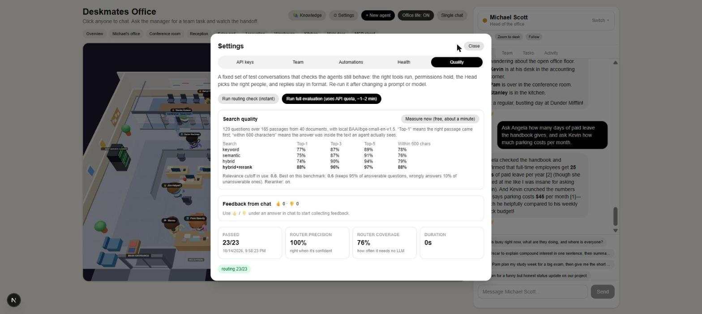

---

## 7. The LLM layer

### 7.1 Providers

| Provider | Key variable | Default models | Default daily estimate per key and model |
|---|---|---|---|
| Google Gemini | `GEMINI_API_KEYS` | `gemini-3.5-flash-lite`, `gemini-3.1-flash-lite`, `gemini-3.8-flash` (smart tier leads with `gemini-3.8-flash`) | 20 |
| Groq | `GROQ_API_KEY` | `llama-3.3-70b-versatile`, `llama-3.1-8b-instant` | 1000 |
| OpenRouter | `OPENROUTER_API_KEY` | `meta-llama/llama-3.3-70b-instruct:free`, `google/gemma-3-27b-it:free` | 50 |
| Cerebras | `CEREBRAS_API_KEY` | `llama-3.3-70b`, `llama3.1-8b` | 1000 |

Keys come from the environment and from the encrypted store managed in Settings. Every provider accepts several keys.

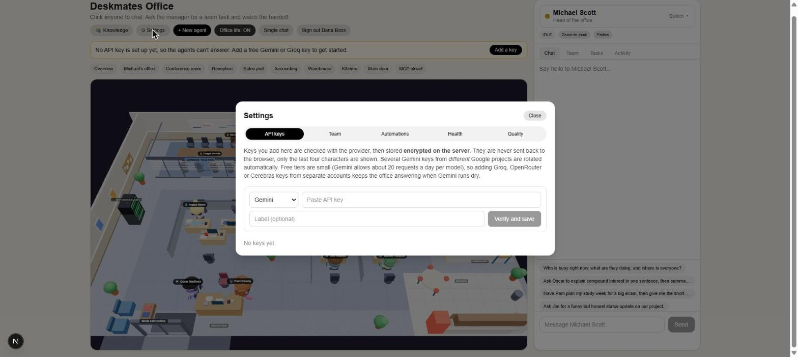

### 7.2 Routing

`get_llm(tier, tools, schema)` builds an ordered candidate list: for each Gemini model, every key (rotated so load spreads), then each fallback provider's models and keys. `QuotaAwareLLM.ainvoke` walks the list:

- A candidate whose `(key, model)` pair is **cooling down** is skipped.
- On failure it classifies the error (`quota`, `busy`, or other). For quota and overload it records a cooldown, using the provider's own "retry in ..." hint when present (otherwise 5 minutes for quota, 30 seconds for overload, capped at 6 hours).
- Every call is counted in `llm_daily` (calls, quota hits, errors) by provider, model and key hash.
- If everything is cooling it raises `QuotaExhausted`, which the UI turns into a plain-language message with the wait.

`ainvoke_retry` adds up to three attempts with exponential backoff and jitter for transient errors (429, 503, timeouts, connection errors).

### 7.3 The quota panel


`GET /quota` estimates what is left today per provider and model: `daily_per_key - calls today`, summed across keys, with a cooling key counted as empty. It assumes each key has its own quota; several keys from one Google project share one. Override the expectation with `DAILY_LIMITS_JSON`, for example `{"gemini": 250}`. The overall `level` is `none`, `ok`, `low` (under 20% left) or `exhausted`, and the studio shows a banner when it is low or exhausted.

---

## 8. Data model

SQLite file `app.db` (path set by `CASTCALL_DATA_DIR`, default `backend/data`). Tables are created on start; later columns are added by `_migrate`. Chat checkpoints live in `checkpoints.db`.

| Table | Purpose | Key columns |
|---|---|---|
| `notes` | Saved notes | user, agent, text, ts |
| `memories` | Long-term memory | user, agent, text, emb, emb_model, ts |
| `traces` | Every model, tool, plan and guard event | ts, user, agent, kind, name, model, prompt_tokens, completion_tokens, latency_ms, status, detail, cost |
| `tasks` | Delegated tasks (the board) | id, parent (the batch), user, agent, task, status, result, created, started, ended |
| `usage` | Messages per user per day | user, day, count |
| `kdocs` | Documents | id, user, name, kind, size, chunks, embedded, scope, created, chunking, hash, origin, synced |
| `ksegments` | Extracted text kept for re-chunking | doc_id, ord, text, locator |
| `kchunks` | Passages | id, doc_id, ord, text, locator, emb, emb_model |
| `ksources` | Connected databases | id, user, name, kind, url (encrypted), schema_text, scope, created |
| `presence` | Last reported location per agent | user, agent, zone, activity, at_desk, ts |
| `workspaces`, `users`, `invites` | Accounts and teams | see section 9.1 |
| `feedback` | Thumbs up/down | id, user, person, agent, message, reply, rating, comment, sources, ts, promoted |
| `schedules` | Scheduled tasks | id, user, agent, message, spec, deliver (encrypted), enabled, next_run, last_run, last_status, last_result |
| `triggers` | Inbound webhooks | id, user, name, agent, token, deliver (encrypted), created, last_used, calls |
| `llm_daily` | Model calls per day | day, provider, model, kid (key hash), calls, quota_hits, errors |
| `api_keys` | Keys added in Settings | id, provider, label, secret (encrypted), status, last_error, disabled |

On disk: `data/.secret_key` (encryption key), `data/.auth_secret` (sign-in signing key), `data/files/` (original uploads), `data/uploads/` (SQLite databases), `data/custom_agents.json`, `data/feedback_cases.json`, `data/eval_runs/`.

The `user` column holds the **scope**: an anonymous browser id with sign-in off, or `ws:<workspace id>` with sign-in on.

---

## 9. Security

### 9.1 Identity, workspaces and roles

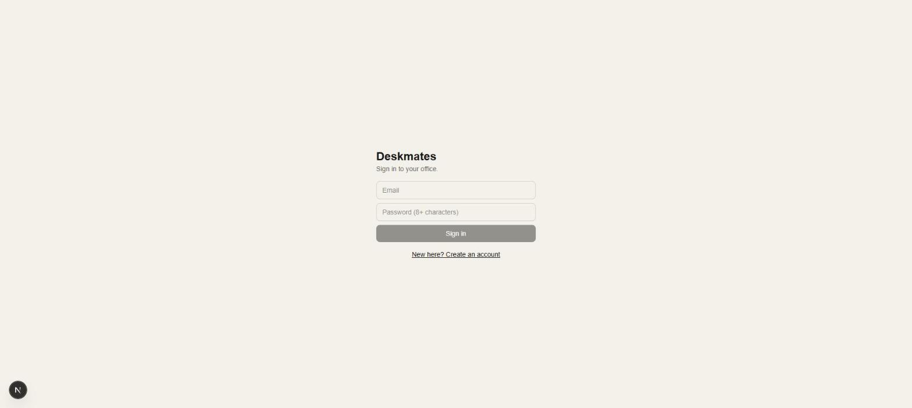

**`AUTH_MODE=off` (default).** The browser sends `X-User-Id` (8 to 64 characters from `A-Za-z0-9_-`). Anything else becomes `anon`. There are no accounts, and chats, documents and agents are private to that id. Admin actions use `ADMIN_TOKEN` (see 9.2).

**`AUTH_MODE=on`.** Every request except the public paths needs `Authorization: Bearer <token>`. Tokens are HS256 JWTs signed with `AUTH_SECRET` (or a generated key), valid for 7 days. Passwords are hashed with scrypt (`n=2**14, r=8, p=1`). After 10 failed sign-ins for the same address and IP within 15 minutes, sign-in returns 429.

| Step | Result |
|---|---|
| First `POST /auth/signup` (no invite) | Creates a workspace and the account becomes its **admin** |
| `POST /auth/signup` with an invite code | Joins that workspace with the invited role (single use, 7 days) |
| `OPEN_SIGNUP=false` | Once a workspace exists, sign-up needs an invite |

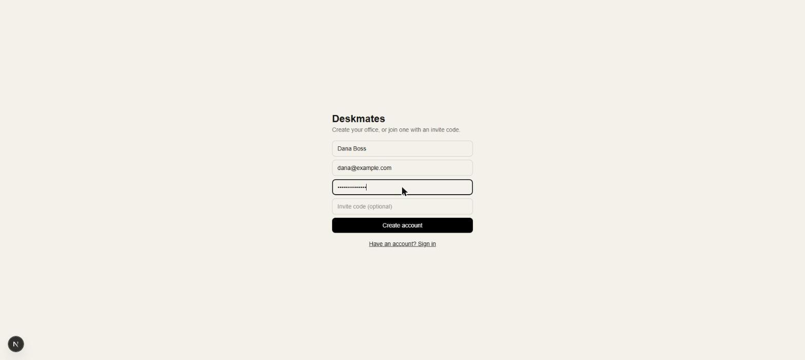

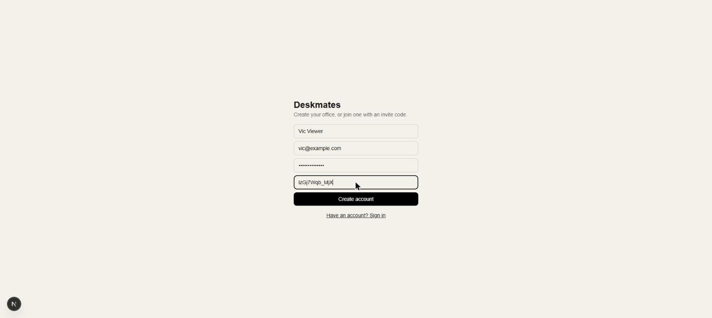

The workspace shares agents, documents, databases, tasks and chat threads. Custom agents are owned by the workspace that made them.

**Role matrix (sign-in on):**

| Capability | viewer | member | admin |
|---|---|---|---|
| Read anything in the workspace (all `GET`) | yes | yes | yes |
| Chat with agents, report presence, rate answers | yes | yes | yes |
| Create, restyle, delete agents; upload documents; schedules; triggers; import | no | yes | yes |
| API keys, database connections, evaluations, promote feedback to tests | no | no | yes |
| Members and invite codes | no | no | yes |

The check is an app-wide dependency (`auth.enforce_role`), not per-route, so a new route is protected by default. Public paths: `/health`, `/auth/config`, `/auth/login`, `/auth/signup`, and `/hooks/<token>`.

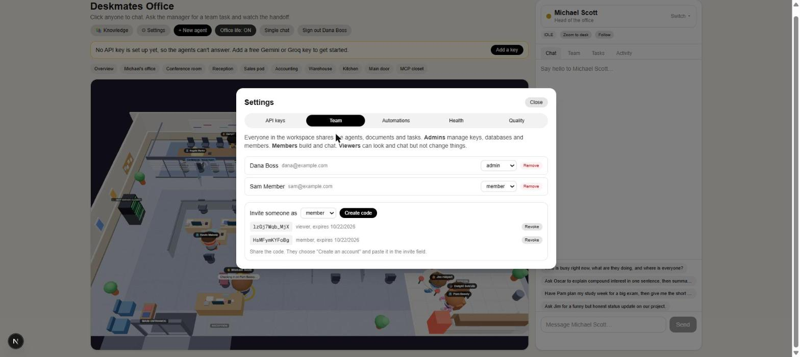

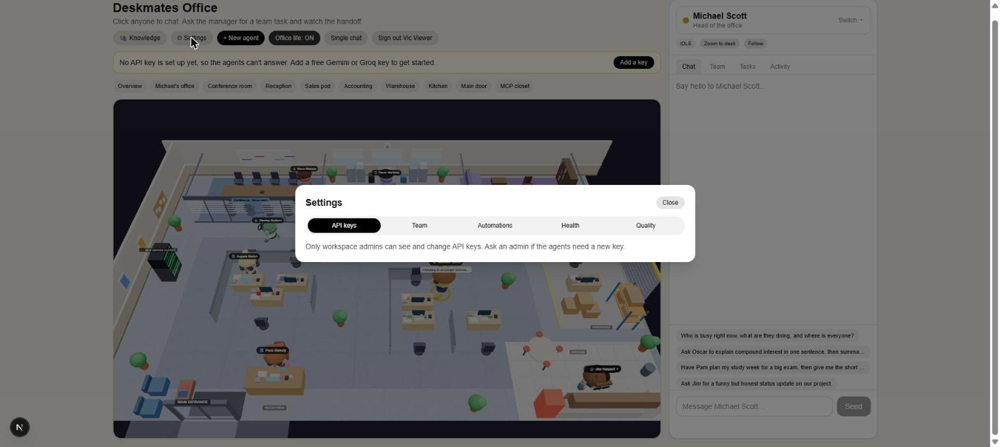

Safeguards: a workspace cannot lose its last admin (demoting or removing the last admin returns 400), and invites can be revoked.

### 9.2 Admin actions with sign-in off

API keys, database connections and evaluation runs call `require_admin`:

- If `ADMIN_TOKEN` is set, the request must send `X-Admin-Token` with the same value.
- If it is not set, these actions are **locked (401)** unless `CASTCALL_ENV=dev`.

The Settings screen shows an unlock box when it gets a 401.

### 9.3 Network safety (SSRF)

Tools and connectors that open network connections must not reach internal addresses or cloud metadata. `safe_url.py` enforces this at **connect time**:

- The hostname is resolved by the guard itself, and **every** address returned must be public (not private, loopback, link-local, reserved, multicast, unspecified; IPv4-mapped IPv6 is unwrapped).
- The HTTP client connects to the **checked address**, so a second DNS answer (rebinding) cannot send the connection elsewhere.
- Every redirect hop goes through the same connect-time check.
- Database hosts are resolved once and pinned (`hostaddr` for PostgreSQL, the address in the URL for MySQL).
- Only `http` and `https` are accepted.

`ALLOW_PRIVATE_HOSTS=true` disables the check for local development (for example a database container). Keep it `false` when the app is exposed.

### 9.4 Prompt injection

- Personas and imported agents are filtered for instruction-override patterns.
- Output of tools that read the outside world is wrapped in `<untrusted source="...">` with a warning attribute when it looks like instructions, and injection-like text is logged to `traces`.
- The system prompt tells agents to treat fenced content as data.

### 9.5 Secrets

API keys, database URLs and delivery links (Slack, webhook) are encrypted with Fernet (`SECRETS_KEY` or a generated `data/.secret_key`), shown only as the last four characters, and never returned by the API. Slack incoming-webhook links must be on `hooks.slack.com`; webhook URLs go through the SSRF guard.

### 9.6 Rate limits

| Limit | Default | Applies to |
|---|---|---|
| `MINUTE_LIMIT` | 12 | chat messages per minute per scope (and per webhook trigger) |
| `DAILY_LIMIT` | 200 | chat messages per day per scope |
| `IP_MINUTE_LIMIT` | 60 | requests per minute per client address (`TRUST_PROXY=true` reads `X-Forwarded-For`) |
| Sign-in failures | 10 per 15 minutes | per address and IP |
| Email delivery | 20 per day | per workspace |

Exceeding a limit returns `429` with a plain-language message.

### 9.7 Summary

| Risk | Mitigation |
|---|---|
| Agents reaching internal networks | Connect-time address checks, redirects and rebinding covered |
| Data-changing SQL | Validator, row cap, timeout, read-only session |
| Prompt injection | Persona filter, fenced untrusted output |
| Key leakage | Encrypted at rest, masked, never returned |
| Cross-workspace access | Data keyed by workspace, ownership checks, app-wide role gate |
| Abuse | Rate limits, throttled sign-in, per-trigger limits |

---

## 10. API reference

Interactive documentation is generated by FastAPI at `/docs` (Swagger) and `/openapi.json`. This section explains behaviour, roles and examples.

### 10.1 Conventions

| Topic | Detail |
|---|---|
| Base URL | `http://localhost:8010` in development |
| Identity | Sign-in off: `X-User-Id: <8-64 chars>` (optional). Sign-in on: `Authorization: Bearer <token>` |
| Admin token | `X-Admin-Token` when `ADMIN_TOKEN` is set |
| Content type | JSON bodies unless stated; uploads are `multipart/form-data` |
| Errors | `{"detail": "plain message"}` with status 400, 401, 403, 404, 409, 422 (validation) or 429 |
| Roles column | Who may call it when sign-in is on: **public**, **viewer** (and above), **member** (and above), **admin** |
| Streaming | `POST /chat` returns `text/event-stream` |

Status codes: `400` rejected input, `401` sign-in or admin token needed, `403` role not allowed, `404` not found (also used for other workspaces' data), `409` already running, `429` rate limit, `502` agent failure on a webhook.

### 10.2 Health and status

| Method and path | Role | Description |
|---|---|---|
| `GET /health` | public | Liveness plus number of keys per provider and the embedding model |
| `GET /quota` | viewer | Estimated AI quota left today |
| `GET /usage` | viewer | Your messages today and the limits |
| `GET /metrics?hours=24` | viewer | Calls, tokens, latency, cost, per-agent, per-model, per-tool tables and model availability |

```json
// GET /health
{"ok": true, "llm": {"gemini": 10, "groq": 0, "openrouter": 0, "cerebras": 0}, "embeddings": "local:BAAI/bge-small-en-v1.5"}

// GET /usage
{"today": 14, "daily_limit": 200, "per_minute": 12}
```

```json
// GET /quota (trimmed)
{
  "level": "ok",
  "estimated_left": 365,
  "providers": [
    {"provider": "gemini", "label": "Google Gemini", "keys": 10, "daily_per_key": 20,
     "models": [
       {"model": "gemini-3.8-flash", "calls_today": 0, "quota_hits": 20, "errors": 0, "keys": 10, "cooling": 10, "estimated_left": 0, "available_in_s": 14800},
       {"model": "gemini-3.5-flash-lite", "calls_today": 35, "quota_hits": 0, "errors": 0, "keys": 10, "cooling": 0, "estimated_left": 165, "available_in_s": 0}
     ]},
    {"provider": "groq", "label": "Groq", "keys": 0, "models": []}
  ]
}
```

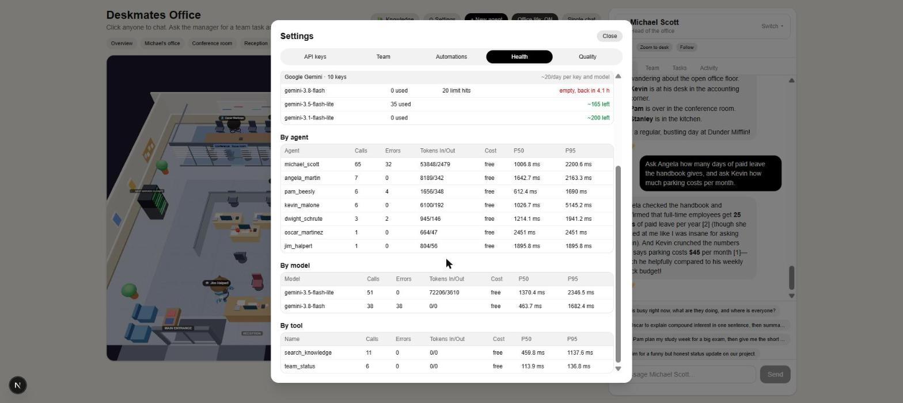

### 10.3 Agents

| Method and path | Role | Description |
|---|---|---|
| `GET /characters` | viewer | The cast visible to you: built-ins plus your workspace's custom agents. Head first. |
| `GET /presets` | viewer | Hireable presets not already in the office |
| `GET /tools/catalog` | viewer | Optional tools: `[{id, description}]` |
| `POST /agents` | member | Create an agent |
| `PATCH /agents/{agent_id}/look` | member | Replace a custom agent's look |
| `DELETE /agents/{agent_id}` | member | Remove a custom agent you own |
| `POST /agents/suggest-from-knowledge` | member | Draft an expert from documents or databases |
| `GET /agents/{agent_id}/history` | viewer | The saved conversation (`[{role: "user"|"agent", text}]`) |

**`POST /agents`**

| Field | Type | Notes |
|---|---|---|
| `name` | string, 1-40 | required |
| `archetype` | string, 1-80 | the role, required |
| `personality` | string, 1-1200 | required; filtered for injection |
| `color` | `#rrggbb` | default `#6d5acd` |
| `look` | object | `hair` (`short`, `bowl`, `messy`, `long`, `bun`, `bald`, `bob`, `slick`, `curly`), `hairColor`, `skin`, `shirt`, `pants`, optional `jacket` and `tie` (hex), `glasses`, `mustache`, `bulk` (0.8-1.4) |
| `tools` | list, up to 5 | `fetch`, `database` |
| `knowledge` | object | `doc_ids`, `source_ids`, `exclusive` (default true), `starters` (up to 5) |

```bash
curl -X POST http://localhost:8010/agents -H "Content-Type: application/json" -H "X-User-Id: my-browser-id" -d '{
  "name": "Rita Records", "archetype": "records keeper", "color": "#445566",
  "personality": "Precise and calm.", "tools": ["fetch"],
  "look": {"hair": "bun", "glasses": true}
}'
```

Errors: `400` if the office is full (19 desks), the personality is rejected, or a knowledge request names nothing you own.

`POST /agents/suggest-from-knowledge` takes `{doc_ids, source_ids}` and returns `{name, archetype, personality, starters, sources}`.

### 10.4 Chat

| Method and path | Role | Description |
|---|---|---|
| `POST /chat` | viewer | Talk to any agent. Streams events (see [section 3](#3-request-lifecycle-and-the-event-stream)). |
| `GET /tasks` | viewer | The recent task board: `[{id, parent, agent, task, status, result, created, started, ended}]` |
| `GET /notes` | viewer | Saved notes: `[{agent, text, ts}]` |

```bash
curl -N -X POST http://localhost:8010/chat -H "Content-Type: application/json" -H "X-User-Id: my-browser-id" \
  -d '{"character_id": "michael_scott", "message": "Who is busy right now?"}'
```

`ChatRequest`: `character_id` (required), `message` (1-4000 characters), `goal` (optional, up to 500, shapes the agent's focus).

### 10.5 Team status

| Method and path | Role | Description |
|---|---|---|
| `POST /presence` | viewer | The office view reports where agents stand: `[{id, zone, activity, at_desk}]` (up to 40) |
| `GET /team/status` | viewer | Live snapshot |

```json
// GET /team/status (one team member)
{"working": 0, "total": 10, "team": [
  {"id": "angela_martin", "name": "Angela Martin", "role": "Strict editor and auditor",
   "state": "idle", "doing": null, "progress": null, "steps": [], "last_result": null,
   "zone": "Accounting corner", "activity": "Filing paperwork...", "at_desk": true,
   "last_seen_zone": null, "last_seen_s": null}
]}
```

### 10.6 Knowledge

| Method and path | Role | Description |
|---|---|---|
| `GET /knowledge` | viewer | `{docs, sources, limits}` |
| `GET /knowledge/strategies` | viewer | Chunking methods, defaults and limits |
| `POST /knowledge/upload` | member | Upload a file (form: `file`, `scope`, `chunking`, `chunk_size`, `overlap`) |
| `POST /knowledge/url` | member | Add a web page or online file `{url, scope?}` |
| `POST /knowledge/{doc_id}/sync` | member | Re-fetch a URL document |
| `GET /knowledge/{doc_id}/file` | viewer | The original file |
| `GET /knowledge/{doc_id}/chunks?limit=8` | viewer | Preview passages `[{ord, locator, text}]` |
| `POST /knowledge/{doc_id}/rechunk` | member | `{strategy, size, overlap}`; re-cuts from stored text |
| `PATCH /knowledge/{doc_id}/scope` | member | `{agents: ["id", ...] | null}` (null = all agents) |
| `POST /knowledge/search` | viewer | `{query, agent_id?}`; the same search agents use |
| `POST /knowledge/reindex` | member | Re-embed stale vectors; `{reindexed, model}` |
| `DELETE /knowledge/{doc_id}` | member | Delete a document |

A document object:

```json
{
  "id": "13af0ab9c1", "name": "office-handbook.md", "kind": "md", "size": 1024,
  "chunks": 5, "embedded": 5, "created": 1792007000.0,
  "origin": {"type": "upload"}, "synced": 1792007000.0, "scope": null,
  "chunking": {"strategy": "structure", "requested": "auto", "size": 500, "overlap": 60, "reason": "5 headings found"}
}
```

When `chunking.requested` is `tuned` (or auto tuned the document), `chunking.tuning` holds `{probes, tested, results: [{strategy, size, overlap, chunks, "hit@600", "hit@1500", score}], chosen}`.

`POST /knowledge/upload` returns the document, or `{..., "unchanged": true}` when identical content was already indexed. Errors are `400` with a plain message (unsupported type, empty file, too large, knowledge base full, no readable text, OCR needs a Gemini key).

```bash
curl -X POST http://localhost:8010/knowledge/upload -H "X-User-Id: my-browser-id" \
  -F "file=@docs/sample-data/office-handbook.md" -F "chunking=auto"
```

```json
// POST /knowledge/search
[{"doc_id": "13af0ab9c1", "ord": null, "doc": "office-handbook.md", "locator": "text · Parking",
  "text": "Parking\nParking permits cost 45 dollars per month...", "score": 0.033, "cosine": 0.71, "bm25": 3.2}]
```

**Databases (admin)**

| Method and path | Description |
|---|---|
| `POST /knowledge/databases` | Connect PostgreSQL or MySQL: `{name, url, scope?}` (the URL is stored encrypted) |
| `POST /knowledge/databases/upload` | Upload a SQLite file (form: `file`, `name`, `scope`) |
| `PATCH /knowledge/databases/{source_id}/scope` | `{agents}` |
| `DELETE /knowledge/databases/{source_id}` | Remove it |

A connection is tested before it is saved. Errors say whether the host is internal, the file isn't SQLite, or the connection failed.

### 10.7 Feedback

| Method and path | Role | Description |
|---|---|---|
| `POST /feedback` | viewer | `{agent_id, message, reply, rating: 1 or -1, comment?, sources?}` |
| `GET /feedback/summary` | viewer | `{up, down, by_agent, needs_attention}` |
| `POST /feedback/promote/{id}` | admin | Turn a thumbs-down into a permanent eval case |

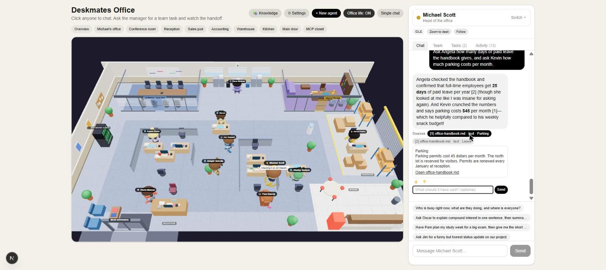

A promoted case stores the question, a "must not repeat the same answer" check (word-overlap below 80%), and, if a note was written, up to three terms the better answer must contain (numbers first, and words the rejected answer didn't already say). It is written to `data/feedback_cases.json` and included in the next evaluation run.

### 10.8 Automation

| Method and path | Role | Description |
|---|---|---|
| `GET /schedules` | viewer | `{schedules, email_ready}` |
| `POST /schedules` | member | Create a schedule |
| `PATCH /schedules/{id}?enabled=true|false` | member | Pause or resume |
| `POST /schedules/{id}/run` | member | Run now; returns `{status, reply}` |
| `DELETE /schedules/{id}` | member | Delete |
| `GET /triggers` | viewer | `{triggers, email_ready}` |
| `POST /triggers` | member | `{name, agent_id, deliver}`; returns the trigger with its `token` |
| `DELETE /triggers/{id}` | member | Delete (revokes the link) |
| `POST /hooks/{token}` | public (the token is the credential) | Ask the trigger's agent |

**`POST /schedules`:**

```json
{
  "agent_id": "oscar_martinez",
  "message": "Summarise yesterday's expenses from the documents.",
  "kind": "weekly", "at": "09:00", "days": [0, 1, 2, 3, 4], "tz_offset_min": 330,
  "deliver": {"slack_url": "https://hooks.slack.com/services/...", "webhook_url": "", "emails": ["boss@example.com"]}
}
```

`kind` is `interval` (`every_min`, 5 to 10,080), `daily` (`at`, `HH:MM`) or `weekly` (`at` and `days`, Monday = 0). Times are in the caller's timezone through `tz_offset_min`.

**`POST /hooks/{token}`** accepts JSON `{"message": "..."}` (or `{"text": "..."}`) and returns `{"reply": "..."}`. It also accepts a Slack slash command (form fields `text` and `response_url`): it answers `{"response_type": "ephemeral", "text": "On it, one moment…"}` immediately and posts the real answer to `response_url` afterwards (the URL must be on `slack.com`).

```bash
curl -X POST http://localhost:8010/hooks/<token> -H "Content-Type: application/json" -d '{"message": "Who is on reception?"}'
```

### 10.9 Settings (admin)

| Method and path | Description |
|---|---|
| `GET /settings/keys` | `{protected, keys: [...]}`; keys are masked (`••••••••AbCd`) |
| `POST /settings/keys` | `{provider, key, label?}`; provider is `gemini`, `groq`, `openrouter` or `cerebras`. The key is verified with a free metadata call and stored encrypted. Returns `{id, status, message}`. |
| `POST /settings/keys/{id}/test` | Re-check a saved key: `{ok, message}` |
| `DELETE /settings/keys/{id}` | Remove it |

### 10.10 Evaluation

| Method and path | Role | Description |
|---|---|---|
| `GET /evals/latest` | viewer | The last full report |
| `GET /evals/status` | viewer | `{running, done, total, error}` |
| `POST /evals/run?routing_only=false&judge=false` | admin | Start a run in the background (live cases use model quota) |
| `GET /evals/retrieval` | viewer | The last search benchmark, the cutoff in use and the reranker setting |
| `POST /evals/retrieval/run` | admin | Re-measure search (local, free) |

### 10.11 Portability

| Method and path | Role | Description |
|---|---|---|
| `GET /export` | viewer | A zip of your custom agents and documents (no keys, databases, chats or notes) |
| `POST /import` | member | Import such a zip (form `file`) |

The zip holds `manifest.json` (version, agents, documents with scopes) and `files/`. Import validates every persona, tools and look, caps agents and documents, renames agents on collision, remaps document scopes to the new agent ids, and rejects path tricks and other versions.

### 10.12 Accounts

| Method and path | Role | Description |
|---|---|---|
| `GET /auth/config` | public | `{auth, open_signup}` |
| `POST /auth/signup` | public | `{email, password, name?, invite?, workspace_name?}`; returns `{token, user}` |
| `POST /auth/login` | public | `{email, password}`; returns `{token, user}` |
| `GET /auth/me` | any signed-in | `{auth, id, email, name, role, workspace}` |
| `GET /auth/members` | admin | `{members, invites}` |
| `PATCH /auth/members/{id}` | admin | `{role}` |
| `DELETE /auth/members/{id}` | admin | Remove a member |
| `POST /auth/invites` | admin | `{role}`; returns `{code, role, expires}` |
| `DELETE /auth/invites/{code}` | admin | Revoke |

With sign-in off, `signup` and `login` return 400 ("Accounts are switched off").

---

## 11. Automation

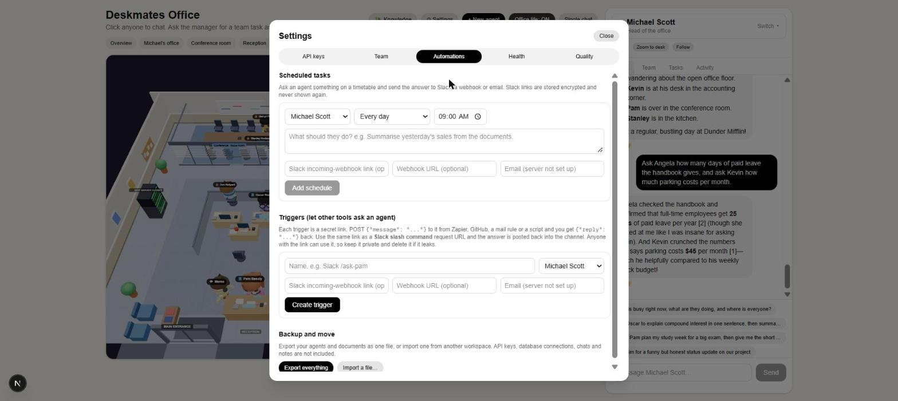

### 11.1 The scheduler

An async loop runs every 30 seconds:

1. Run every enabled schedule whose `next_run` has passed. The next run time is advanced **before** running, so a slow run is never started twice.
2. Every `SYNC_INTERVAL_MIN` minutes (0 disables) re-sync web-page documents and the watched folder.

Each run asks the agent as that workspace (respecting its daily message limit), delivers the answer, and records `last_run`, `last_status` (`ok`, `delivered with problems: ...`, or `failed: ...`) and `last_result`. A failed run never raises.

### 11.2 Delivery

| Destination | Setup | Notes |
|---|---|---|
| Slack | An incoming-webhook link | Must be `https://hooks.slack.com/...`; stored encrypted |
| Webhook | Any URL | Sends `{title, text}`; SSRF-guarded |
| Email | `SMTP_HOST` (and friends) | Up to 5 addresses; 20 emails per day per workspace |

### 11.3 Triggers and Slack slash commands

A trigger is a secret URL that asks an agent. Use it from Zapier, GitHub, a script, or as a **Slack slash command**: set the command's request URL to `https://your-host/hooks/<token>`. Slack requires an answer within three seconds, so Deskmates acknowledges at once and posts the real answer to Slack's `response_url`. Treat the link like a password: anyone who has it can use that trigger (rate limited per trigger). Deleting the trigger revokes it.

---

## 12. Frontend

### 12.1 Routes

| Route | What |
|---|---|
| `/studio` | The office: 3D scene, chat panel (Chat, Team, Tasks, Activity), Knowledge, Settings, New agent |
| `/` | Single-chat page with a roster, history and starters |
| `/cast` | A 3D lineup of everyone in the office and everyone you can hire |

Each route is a small **server** entry (`page.tsx`) that renders the interactive **client** component (`studio-client.tsx`, `home-client.tsx`, `cast-client.tsx`).

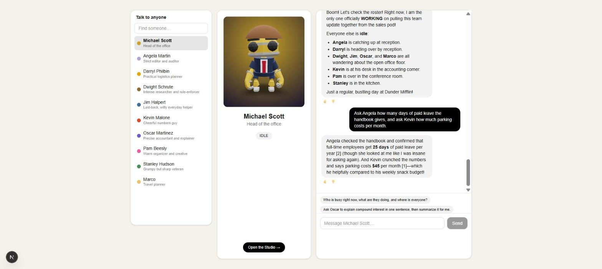

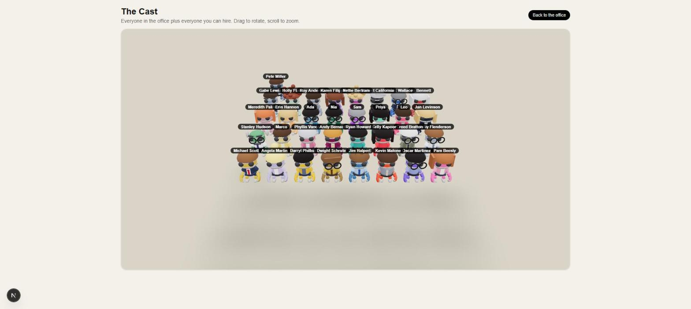

### 12.2 Structure

```
frontend/src/
  app/
    layout.tsx                 root layout, wraps everything in AuthGate
    page.tsx, home-client.tsx  single chat
    studio/                    the office
    cast/                      the lineup
  components/
    AuthGate.tsx               sign-in / sign-up screen and sign-out button
    KnowledgeModal.tsx         upload, URLs, chunking, preview, test search, databases
    ExpertModal.tsx            expert from knowledge
    SettingsModal.tsx          keys, team, health
    AutomationsTab.tsx         schedules, triggers, backup
    QualityExtras.tsx          search benchmark and feedback cards
    MessageExtras.tsx          source chips and thumbs
    AgentRoster.tsx, Markdown.tsx, CharacterStage.tsx
    studio/                    StudioScene, OfficeSet, Character, LookEditor, LookPreview, CastLineup, Tag
  lib/api.ts                   apiFetch with identity and admin headers
```

### 12.3 How the UI talks to the API

- `apiFetch(path, init)` adds `X-User-Id` (a random id kept in `localStorage`), `Authorization` when signed in, and `X-Admin-Token` when set. A 401 while signed in clears the token and returns to the sign-in screen.
- Chat reads the SSE stream with `fetch` and a `ReadableStream`, parsing `data:` lines. The same events drive the 3D scene, the Tasks board, the Activity log and the source chips.
- The office reports agent positions to `POST /presence` every 2.5 seconds.
- Browser storage is used only for the anonymous id and the sign-in token. Older versions stored them under `castcall-*` keys; they are migrated automatically on first load.

### 12.4 The 3D scene

react-three-fiber renders `OfficeSet` (rooms, desks, doors, props) and a `Character` per agent (a rigged robot model dressed from the agent's `look`). Movement, desk work, doors and the main entrance are simulated in the browser. Real work (delegations, tool calls) comes from the event stream and takes priority. New hires walk in through the main door and removed agents walk out of it.

| | |
|---|---|
| 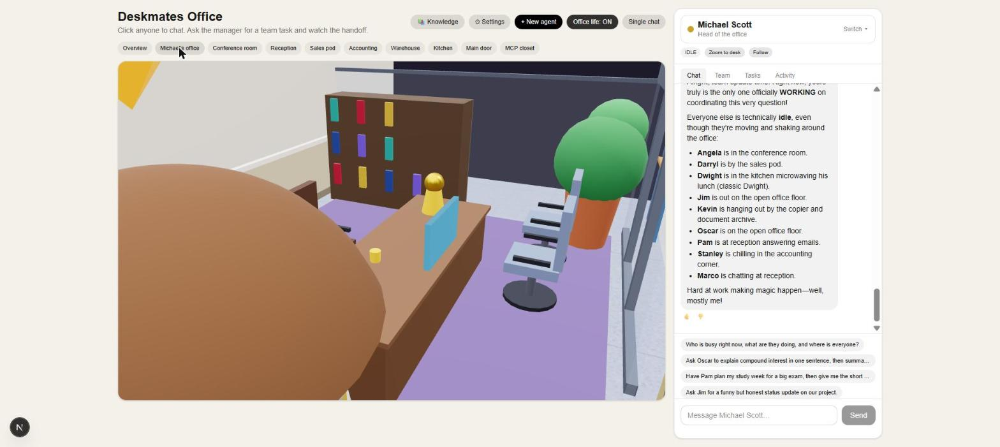 | 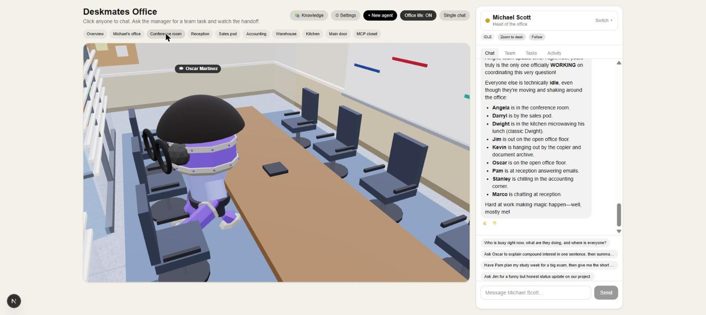 |
| 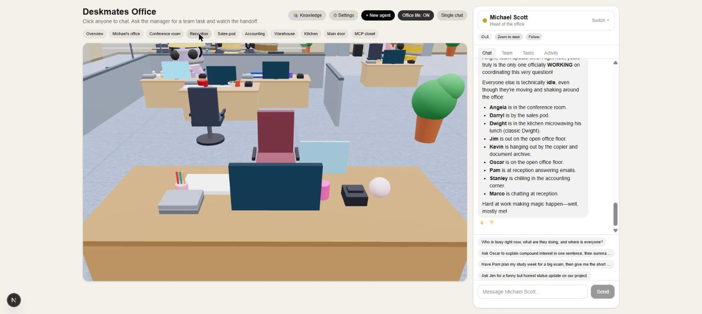 | 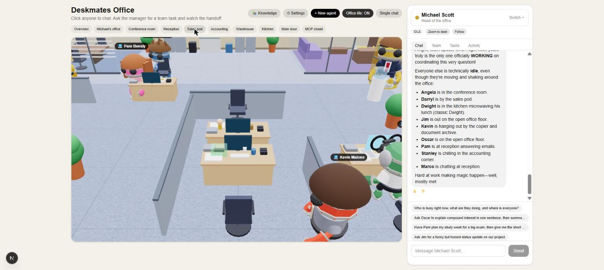 |
| 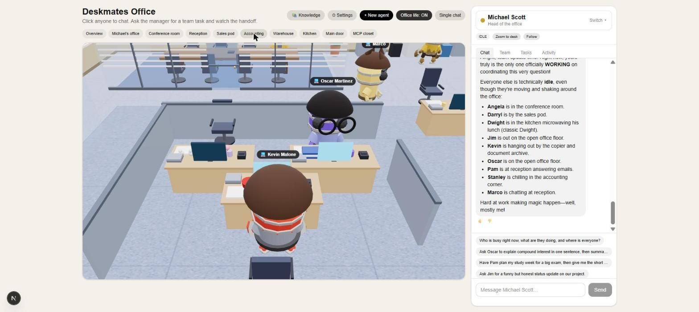 | 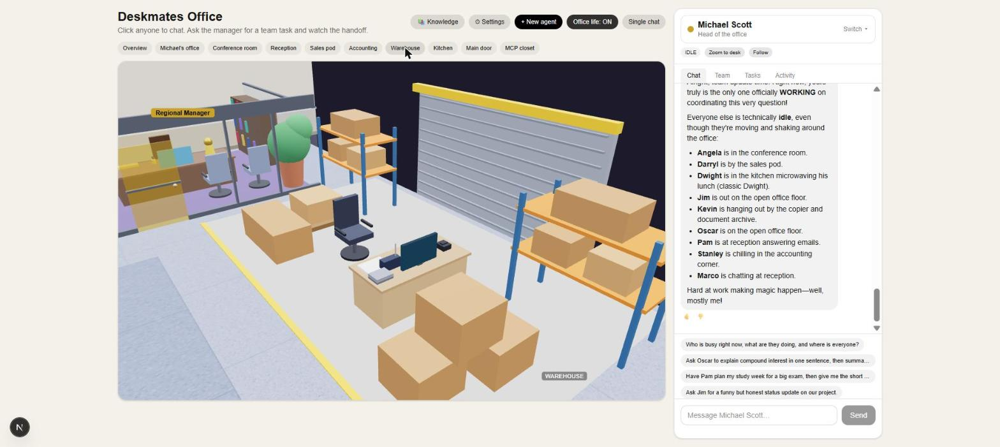 |
| 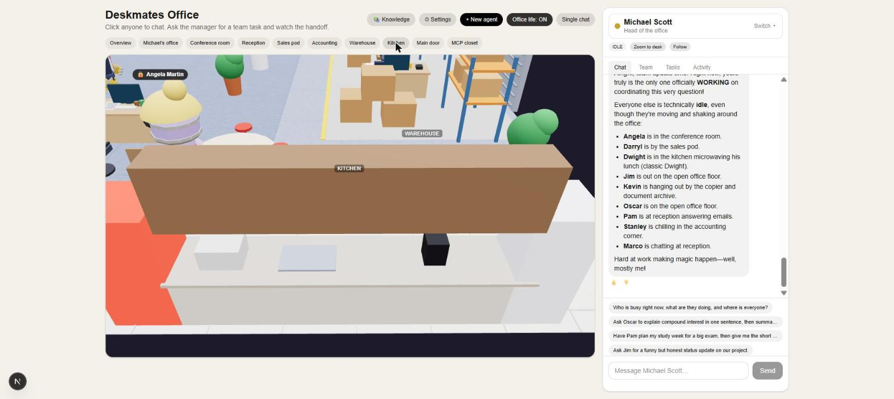 | 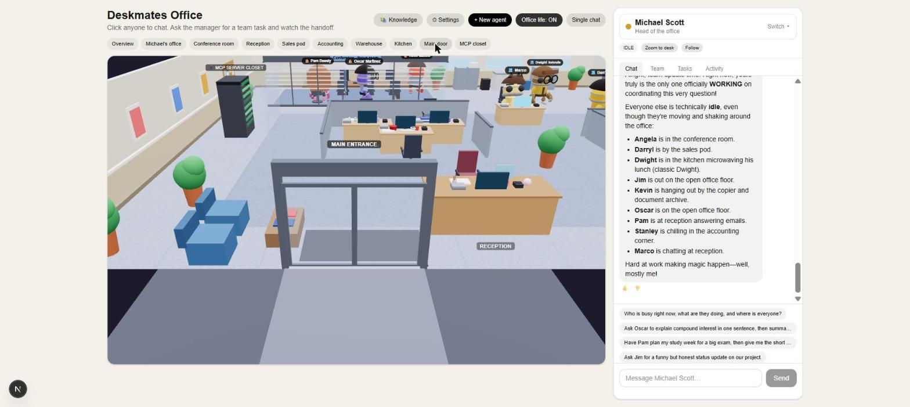 |

### 12.5 Developer notes

- Next.js 16 with Cache Components. Because the pages are live client apps, each page's server entry exports `instant = false`.
- React Strict Mode is off in development (`next.config.ts`) because drei's `<Html>` labels clash with its double-effect check; production is unaffected.
- Lint: `npm run lint` (0 errors; a few advisory warnings). The react-three-fiber files relax the "no mutation" rules because per-frame mutation is how that library works.

---

## 13. Evaluation and testing

### 13.1 Automated tests

```bash
docker compose exec backend python -m pytest -q                       # everything (about 260 tests)
docker compose --profile test up -d pg-test mysql-test
docker compose exec backend python -m pytest -m integration -q        # real Postgres and MySQL
```

The test environment forces empty API keys and `EMBEDDINGS=none`, uses a temporary data folder, and replaces the model with a scripted fake, so tests never spend quota.

| File | Covers |
|---|---|
| `test_core.py`, `test_api.py` | Agents, guard, planner, tools, endpoints |
| `test_rag.py`, `test_chunking.py`, `test_tuning.py`, `test_rerank.py` | Extraction, chunking, tuning, search, reranking, SQL safety |
| `test_cite_sync.py` | Citations, original files, document updates, URL and folder sync |
| `test_security.py` | SSRF, DNS rebinding, admin lock, rate limits |
| `test_auth.py` | Sign-in, workspaces, roles, invites, isolation |
| `test_quota.py` | Providers, fallback, quota estimate |
| `test_scheduler.py` | Schedules, triggers, Slack, delivery |
| `test_bundle.py`, `test_feedback.py`, `test_presence.py` | Export/import, feedback to tests, live status |
| `test_integration_db.py` | Real PostgreSQL and MySQL |
| `test_heldout.py`, `test_ocr_eval.py` | Held-out router and status checks, the OCR harness |

### 13.2 Evaluations

| Command | What it measures | Cost |
|---|---|---|
| `python -m evals.run --routing-only` | Router precision and coverage on 23 cases | none |
| `python -m evals.run` | Live conversations: tools, permissions, planning, status, RAG, format | model quota |
| `python -m evals.retrieval` | Keyword, semantic, hybrid and reranked search; cutoff sweep; chunking comparison | none (local) |
| `python -m evals.heldout` | Router and status patterns on cases written after tuning | none |
| `python -m evals.ocr` | OCR on deliberately messy scans | model quota |

The router's precision is 100% on the main set and **84% when confident** on the held-out set (the rest defer to the LLM planner). Status patterns first scored 72% held-out; they were then fixed against those same cases, so their current score is optimistic. The cases and corpus were generated or written for this project, so treat all numbers as regression guards.


---

## 14. Configuration reference

All variables live in `backend/.env` (see `backend/.env.example`). Everything is optional except at least one AI key. The `CASTCALL_` prefix on `CASTCALL_ENV` and `CASTCALL_DATA_DIR` is historical and kept for compatibility.

### AI providers

| Variable | Default | Meaning |
|---|---|---|
| `GEMINI_API_KEYS` | empty | Comma-separated Google keys, rotated |
| `GEMINI_MODELS` | `gemini-3.5-flash-lite,gemini-3.1-flash-lite,gemini-3.8-flash` | Fast tier order |
| `GEMINI_MODELS_SMART` | `gemini-3.8-flash,gemini-3.5-flash-lite,gemini-3.1-flash-lite` | Smart tier order |
| `GROQ_API_KEY`, `GROQ_MODELS` | empty, `llama-3.3-70b-versatile,llama-3.1-8b-instant` | `GROQ_MODEL` (single) still works |
| `OPENROUTER_API_KEY`, `OPENROUTER_MODELS` | empty, free Llama and Gemma | |
| `CEREBRAS_API_KEY`, `CEREBRAS_MODELS` | empty, `llama-3.3-70b,llama3.1-8b` | |
| `DAILY_LIMITS_JSON` | built-in estimates | Override quota expectations, e.g. `{"gemini": 250}` |
| `PRICES_JSON` | none | USD per million tokens `[input, output]` per model, for the cost columns |

### Search

| Variable | Default | Meaning |
|---|---|---|
| `EMBEDDINGS` | `auto` | `auto`, `local`, `gemini`, `none` |
| `EMBED_MODEL_LOCAL` | `BAAI/bge-small-en-v1.5` | Any sentence-transformers model |
| `RERANKER` | `auto` | `auto` (on with local embeddings), `on`, `off`, or a model name |
| `RERANK_MODEL` | `cross-encoder/ms-marco-MiniLM-L-6-v2` | |
| `AUTO_TUNE` | `true` | Let `auto` chunking measure on long ambiguous documents |

### Security

| Variable | Default | Meaning |
|---|---|---|
| `CASTCALL_ENV` | `prod` | `dev` leaves admin actions open; the compose file sets it for local use |
| `ADMIN_TOKEN` | empty | Required for admin actions when sign-in is off and not in dev |
| `AUTH_MODE` | `off` | `on` enables accounts and workspaces |
| `OPEN_SIGNUP` | `true` | `false`: after the first workspace, sign-up needs an invite |
| `AUTH_SECRET` | generated | Signing key for sign-in tokens |
| `SECRETS_KEY` | generated | Fernet key for stored secrets |
| `ALLOW_PRIVATE_HOSTS` | `false` | Allow tools and connectors to reach private addresses |
| `TRUST_PROXY` | `false` | Read the client address from `X-Forwarded-For` |
| `CORS_ORIGINS` | `http://localhost:3000` | Allowed browser origins |

### Limits

| Variable | Default |
|---|---|
| `DAILY_LIMIT` | 200 messages per day per scope |
| `MINUTE_LIMIT` | 12 per minute |
| `IP_MINUTE_LIMIT` | 60 per minute per address |

### Automation

| Variable | Default | Meaning |
|---|---|---|
| `SCHEDULER` | `on` | `off` disables the background loop |
| `SYNC_INTERVAL_MIN` | 30 | Minutes between document syncs (0 = never) |
| `KNOWLEDGE_WATCH_DIR` | empty | Folder (inside the container) to mirror |
| `KNOWLEDGE_WATCH_USER` | `anon` | Whose knowledge base the folder feeds (a scope such as `ws:...`) |
| `SMTP_HOST`, `SMTP_PORT`, `SMTP_USER`, `SMTP_PASSWORD`, `SMTP_FROM`, `SMTP_STARTTLS` | none, 587, none, none, none, true | Email delivery |

### Data

| Variable | Default | Meaning |
|---|---|---|
| `CASTCALL_DATA_DIR` | `backend/data` | Database, uploads and keys |

---

## 15. Deployment

Production checklist:

1. **Identity.** Set `AUTH_MODE=on` and, once your team has joined, `OPEN_SIGNUP=false`. With sign-in off, at least set `ADMIN_TOKEN`.
2. **Remove development settings.** Delete `CASTCALL_ENV=dev` and `ALLOW_PRIVATE_HOSTS=true` from `docker-compose.yml`.
3. **HTTPS and proxy.** Put a reverse proxy with TLS in front. Set `TRUST_PROXY=true` (only behind a proxy you control) and `CORS_ORIGINS` to your real origin. Set `NEXT_PUBLIC_API_URL` for the frontend build.
4. **Network.** Restrict the backend's outbound traffic as a second layer behind the connect-time SSRF checks.
5. **Secrets.** Set `AUTH_SECRET` and `SECRETS_KEY` explicitly so tokens and stored secrets survive moving the data folder.
6. **Backups.** Back up `backend/data` (database, uploads, keys, files).
7. **Frontend build.** Use `npm run build` and `next start` rather than the dev server. The build is checked in the verification steps.
8. **Resource notes.** The backend loads two small models (about 200 MB on disk). The first request after a restart may wait for the model warm-up.

---

## 16. Extending Deskmates

| Want to add | Where |
|---|---|
| A model provider | Add an entry to `PROVIDERS` in `llm.py` (env var, models, base URL if OpenAI-compatible, daily estimate), a branch in `validate_key`, and the name to `NewKey.provider` in `main.py` |
| An MCP server | `MCP_SERVERS` in `agent.py`; permissions in `policy.py` (section 5.3) |
| A built-in tool | Define it in `make_tools` in `agent.py` (use `@tool`), add its name to `BASE_TOOLS` or an optional group in `policy.py` |
| A chunking strategy | Add it to `STRATEGIES` and `build_chunks` in `chunking.py`; the UI lists strategies from `GET /knowledge/strategies` |
| A file type | Add an extractor in `knowledge.extract` returning `Segment(text, locator)` items and list the extension in `SUPPORTED` |
| An endpoint | Add the route in `main.py`. It is protected by the role gate automatically; add the path to `ADMIN_PREFIXES` in `auth.py` if admin-only |
| An eval case | Add to `backend/evals/cases.json`, or let 👍/👎 and "Add to tests" create one |
| A preset agent | Append to `backend/presets.json` |
| A built-in character | Add a JSON file in `backend/characters/` |

---

## 17. Troubleshooting

| Symptom | Likely cause and fix |
|---|---|
| "Can't reach the backend" | The backend may still be starting after a restart. Reload. Check `docker compose ps` and `docker compose logs backend`. |
| Agents say they are out of quota | See Settings > Health. Add keys from other accounts or providers. |
| "No API key is set up yet" | Add a key in Settings > API keys, or in `backend/.env`. |
| Admin screens ask for a token | Set `ADMIN_TOKEN` and enter it in Settings, or use `CASTCALL_ENV=dev` locally. |
| Search finds nothing | The relevance cutoff may be hiding weak matches, or embeddings are off (`EMBEDDINGS=none`). Try "Test a search" in Knowledge. |
| A scan or image is rejected | Reading images needs a Gemini key; files over 8 MB are refused. |
| A database will not connect | Hosts on private addresses are blocked unless `ALLOW_PRIVATE_HOSTS=true`. Check the URL and credentials. |
| The dev server shows stale code | `docker compose restart frontend` (the Windows mount can lag behind file changes). |
| Port already in use | The backend is on host port 8010 and the frontend on 3000; change them in `docker-compose.yml`. |

---

## 18. Limits

- Free tiers are small and the quota panel is an estimate from the app's own counts.
- The benchmarks, eval sets and held-out cases were generated or written for this project.
- OCR is stress-tested on generated scans only.
- Sign-in, schedules, triggers and Slack, email and webhook delivery are covered by tests with stand-ins, not live services.
- SQLite suits a team, not heavy multi-user load. Conversation threads are shared inside a workspace.
- The first workspace created becomes admin; there is no email verification or password reset.

---

## Screenshot gallery

Click a thumbnail for the full-size image.

### The office

| | | |
|---|---|---|
| [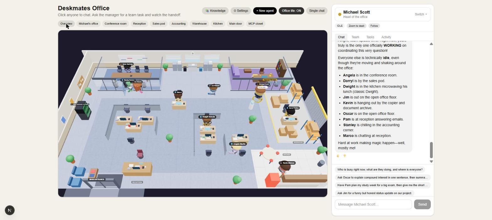](screenshots/office-overview.jpg)<br>Overview | [](screenshots/room-michaels-office.jpg)<br>Michael's office | [](screenshots/conference-room.jpg)<br>Conference room |
| [](screenshots/room-reception.jpg)<br>Reception | [](screenshots/room-sales-pod.jpg)<br>Sales pod | [](screenshots/room-accounting.jpg)<br>Accounting |
| [](screenshots/room-warehouse.jpg)<br>Warehouse | [](screenshots/room-kitchen.jpg)<br>Kitchen | [](screenshots/room-main-door.jpg)<br>Main door |
| [](screenshots/room-mcp-closet.jpg)<br>MCP closet | [](screenshots/cast-lineup.jpg)<br>The cast | [](screenshots/single-chat.jpg)<br>Single chat |

### Working with agents

| | | |
|---|---|---|
| [](screenshots/team-status.jpg)<br>Team status | [](screenshots/live-status.jpg)<br>Live status answer | [](screenshots/handoff-in-progress.jpg)<br>Handoff in progress |
| [](screenshots/tasks-handoff.jpg)<br>Tasks | [](screenshots/activity-log.jpg)<br>Activity log | [](screenshots/hire-agent.jpg)<br>Hire from presets |
| [](screenshots/hire-custom-agent.jpg)<br>Create your own | [](screenshots/look-editor.jpg)<br>Look editor | [](screenshots/expert-from-knowledge.jpg)<br>Expert from knowledge |

### Knowledge and answers

| | | |
|---|---|---|
| [](screenshots/knowledge.jpg)<br>Knowledge | [](screenshots/knowledge-chunking-preview.jpg)<br>Chunking and preview | [](screenshots/knowledge-test-search.jpg)<br>Test a search |
| [](screenshots/knowledge-database-connect.jpg)<br>Connect a database | [](screenshots/citations.jpg)<br>Source citations | [](screenshots/feedback-thumbs-down.jpg)<br>Feedback |

### Settings, quality and teams

| | | |
|---|---|---|
| [](screenshots/settings-api-keys.jpg)<br>API keys | [](screenshots/health-quota.jpg)<br>Health and quota | [](screenshots/health-by-agent.jpg)<br>Cost by agent, model, tool |
| [](screenshots/quality.jpg)<br>Search quality | [](screenshots/automations.jpg)<br>Automations | [](screenshots/team-invites.jpg)<br>Team and invites |
| [](screenshots/auth-sign-in.jpg)<br>Sign in | [](screenshots/auth-sign-up.jpg)<br>Create an office | [](screenshots/auth-join-with-invite.jpg)<br>Join with invite |
| [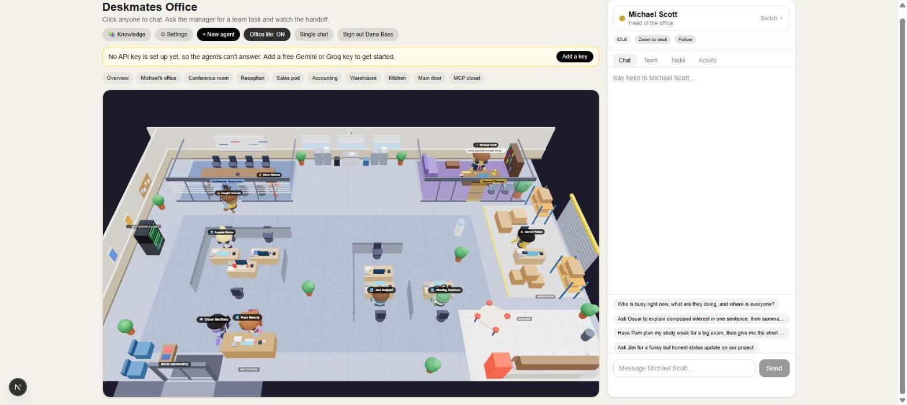](screenshots/auth-signed-in-admin.jpg)<br>Signed in | [](screenshots/viewer-restricted.jpg)<br>Viewer role | |
